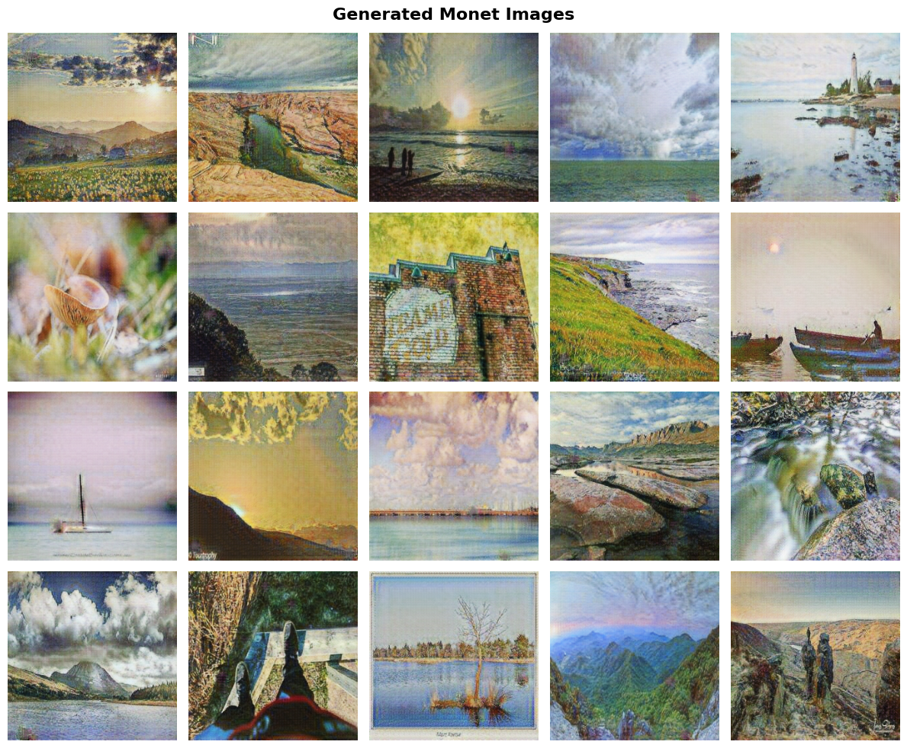
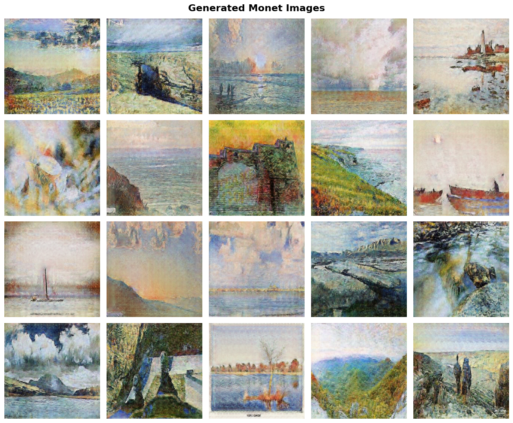

# Monet Style Transfer: CycleGAN vs. CUT

## 1. Introduction

This project explores image-to-image translation as part of Kaggle’s **“I’m Something of a Painter Myself”** competition. Its goal is to transform photographs into artwork in the style of Claude Monet using unpaired datasets.

### 1.1. Technical Approach

A key feature of this project is that both architectures were implemented using **TensorFlow**, without additional high-level libraries or ready-made frameworks. The model architectures, training loops, and loss functions were built from scratch, enabling an in-depth analysis of how the architectures work.

### 1.2. Research Focus

The project examines and compares two fundamentally different approaches to preserving image content:

- **CycleGAN:** Relies on bidirectional mappings and cycle-consistency loss.
- **CUT (Contrastive Unpaired Translation):** Uses patch-wise contrastive learning and offers greater computational efficiency.

### 1.3. Evaluation Metric

**MiFID (Memorization-informed Fréchet Inception Distance)** was used to evaluate the generated images. This metric allows us to assess their visual similarity to Monet’s style while accounting for the risk of memorizing the training data.

## 2. CycleGAN: Architecture and Experimental Analysis

### 2.1. Architecture Overview and Loss Functions

The central idea behind CycleGAN is bidirectional translation between two domains: $G: X \to Y$ and $F: Y \to X$. The model is optimized using a combination of three main components, as presented in the original paper (*Zhu et al., 2017*):

1. **Adversarial Loss:** Encourages visually realistic generated images.
2. **Cycle-Consistency Loss:** Enforces $F(G(X)) \approx X$, helping preserve image structure.
3. **Identity Loss:** Helps preserve the color palette when an image from the target domain is passed to the generator.

Our implementation initially used the standard parameters from the paper: `lambda_cycle = 10` and `lambda_id = 5`.

### 2.2. Initial Stage: 128 × 128 Resolution

To better understand the model’s training dynamics and optimize resource use, we initially used images at a resolution of 128 × 128 pixels. Several key experiments were tracked using **Weights & Biases (WandB)**.

#### 2.2.1. `base_run` and `cyclegan_default_run`: 30 vs. 50 Epochs

In the first experiment, **`cycle_gan_base_run`**, the model was trained for 30 epochs.

- **Results:** FID - 85; MiFID - 1085.
- **Observation:** The plots indicated that the model approached convergence around epoch 30. The analysis below also considers this result.

We then tried extending training to 50 epochs using the same parameters, although this is listed below as a separate run. Unexpectedly, the results deteriorated:

- **Results at 50 epochs:** MiFID increased to 1095.
- **Analysis:** Although the FID score of 85 was relatively low and favorable, the high MiFID score suggested that the model had begun memorizing the training data, as reflected in MiFID’s memorization penalty.

[View `base_run` details on WandB](https://wandb.ai/MLBeasts/monet-cyclegan/runs/19b7ed35?nw=nwuserzhorzholianimate)

[View `cyclegan_default_run` details on WandB](https://wandb.ai/MLBeasts/monet-cyclegan/runs/6ffa9e28?nw=nwuserzhorzholianimate)

#### 2.2.2. `mifid_safe_run`

To improve the MiFID score and reduce memorization, we conducted an experiment called **`mifid_safe_run`**. In this run, we changed the loss weights to `lambda_cycle = 5` and `lambda_id = 0`. The aim was to give the model greater freedom in interpreting the style and reduce strict structural constraints.

- **Results:** FID - 235; MiFID - 1235.
- **Analysis:** Although the memorization score improved slightly, the overall MiFID score became substantially worse because of the sharp increase in FID. The model lost image quality and structural accuracy.

[View `mifid_safe_run` details on WandB](https://wandb.ai/MLBeasts/monet-cyclegan/runs/8989d233?nw=nwuserzhorzholianimate)

#### 2.2.3. Interim Conclusion

Experiments with 128 × 128 images showed that, with low-resolution data, CycleGAN could readily learn the available information and enter a memorization phase at later epochs. MiFID proved particularly sensitive in this setting: a model that produced visually convincing images with a low FID could still receive a poor MiFID score because of a high memorization penalty.

This suggested that a resolution of 128 pixels was not optimal for this particular task and that a different approach or a higher resolution was needed.

### 2.3. CycleGAN at 256 Pixels: Architectural Optimization and Experiments

Following the experiments at 128 pixels, we moved to the main task: processing images at a resolution of 256 × 256 pixels. At this stage, we used the full architecture with **nine residual blocks**, providing sufficient model capacity to learn higher-resolution details.

#### 2.3.1. `256px_fast_run`: Initial Test

First, we conducted a short, 10-epoch test called **`256px_fast_run`**, using the following configuration:

- **Capacity:** Nine residual blocks.
- **Learning rate:** 0.0003, slightly increased to accelerate learning.
- **Loss weights:** `lambda_cycle = 3.0`, `lambda_identity = 0.0`, with the aim of preventing memorization.

**Results:** FID - 70; MiFID - 1070.

Although the FID score was relatively low and favorable, the high MiFID score indicated that the model remained prone to memorization even after a short training period.

[View `256px_fast_run` on WandB](https://wandb.ai/MLBeasts/monet-cyclegan/runs/2c415937?nw=nwuserzhorzholianimate)

#### 2.3.2. Random Batch Pairing Methodology

To address memorization, I changed the data-loading logic. Instead of the fixed photo–painting pairings often used during training in conventional CycleGAN setups, I introduced **random batch pairing**. With this approach, each photograph was paired with a randomly selected painting at every training step, encouraging the model to learn the general style rather than memorize specific pairs.

Two main 30-epoch runs used this method:

1. **`random_batch_cyclegan_256_ptx` - Paper Parameters**

   We used the parameters from the original paper: `lambda_cycle = 10` and `lambda_identity = 5`.

   - **Results:** FID - 196; MiFID - 638.
   - [View the run on WandB](https://wandb.ai/MLBeasts/monet-cyclegan/runs/99d1241b?nw=nwuserzhorzholianimate)

2. **`random_batch_cyclegan_256_ptx_low_mem` - Safe Parameters**

   We reduced the loss weights to prevent memorization: `lambda_cycle = 5` and `lambda_identity = 0`.

   - **Results:** FID - 197; MiFID - 686.
   - [View the run on WandB](https://wandb.ai/MLBeasts/monet-cyclegan/runs/6b0195ad?nw=nwuserzhorzholianimate)

#### 2.3.3. Comparison and Analysis of Results

Comparing the experiments showed that changing the loss weights in the `low_mem` configuration had little effect on MiFID. In fact, the higher, standard weights produced slightly better results.

**Analysis of the training plots:**

- In `random_batch_cyclegan_256_ptx`, the cycle-consistency and identity losses converged relatively quickly and remained low throughout the 30 epochs. This explains why `random_batch_cyclegan_256_ptx` and `random_batch_cyclegan_256_ptx_low_mem` produced very similar results. Changing the regularization weights had limited impact because, once the model converged, the corresponding losses were already very small-practically zero.
- However, the main **adversarial loss**, reflecting the competition between the generator and discriminator, remained highly unstable. Large fluctuations in the plots suggested that considerably more training was needed to reach a stable equilibrium.

#### 2.3.4. Interim Conclusion

Although random batch pairing improved MiFID from approximately 1000 to around 600, 30 epochs were insufficient to realize CycleGAN’s full potential. The unstable losses suggested that additional epochs were needed, but limited computational resources prevented further training.

## 3. Contrastive Unpaired Translation (CUT): An Efficient Alternative

Because of CycleGAN’s computational demands and convergence difficulties, the next stage of the project focused on **CUT**. This architecture offers a more recent approach to unpaired image-to-image translation that does not rely on cycle consistency.

### 3.1. Architecture Overview and Innovation

CUT’s central innovation is **patch-wise contrastive learning**. Instead of performing a cyclic transformation, the model seeks to maximize the mutual information between the input and output images.

**Key components:**

1. **A Single Generator:** Unlike CycleGAN, CUT uses only one generator, significantly reducing the number of parameters and accelerating training.
2. **Projection Head (MLP):** Features extracted from intermediate generator layers are passed through a multilayer perceptron, which projects them into a representation space for contrastive learning.
3. **PatchNCE Loss:** This is the core of the model. It encourages a particular patch-a small region-of the output image to resemble the corresponding patch of the original image while remaining distinct from other, “negative” patches.

### 3.2. Loss Functions and Parameters

The model is optimized using two main loss functions:

- **Adversarial Loss:** A standard GAN loss that encourages visual realism.
- **PatchNCE Loss:** A contrastive loss applied at several generator layers, specified by `nce_layers`.

Our optimal configuration, based on the original paper, was as follows:

```python
cut_config_optimal = {
    "run_name": "cut-monet-optimal",
    "num_residual_blocks": 9,  # Standard depth for high-quality results
    "num_downsampling": 2,     # For 256x256 resolution
    "nce_layers": [0, 4, 8, 12],  # Four layers selected for feature extraction
    "nce_dim": 256,            # Projection dimension
    "num_patches": 256,        # Number of patches per step
    "nce_temperature": 0.07,   # Scaling parameter
    "lambda_NCE": 1.0,         # Contrastive loss weight
    "lambda_identity": 0.0,    # No identity loss
    "num_epochs": 50,          # More epochs enabled by computational efficiency
    "lr": 0.0002
}
```

### 3.3. Experimental Results: 50 Epochs

The simplicity of the CUT architecture, with only one generator, allowed us to train the model for **50 epochs**, which had not been feasible for the full CycleGAN setup given our resource constraints. Several simplified versions were also tested early on to develop intuition ([example run](https://wandb.ai/MLBeasts/monet-cut/runs/00b2e0ec)), but the main focus was the “Optimal” run.

**Results:**

- **FID:** 150
- **MiFID:** 550

**Convergence analysis:**

The training process approached full convergence.

- **Adversarial loss** and other supporting metrics stabilized, indicating a good balance between the generator and discriminator.
- **NCE loss** did not fully converge, which is typical of contrastive learning given its complexity, but it showed a steady downward trend.

### 3.4. Interim Conclusion

Over 50 epochs, CUT demonstrated strong stability and good content preservation, achieving an FID of 150 and a MiFID of 550. However, some weaknesses also emerged. The model successfully avoided memorizing the data because of its less conservative nature, but the contrastive objective, measured by NCE loss, had still not fully converged after 50 epochs. This suggested that the model sometimes “hallucinated” additional artistic elements at the expense of the original image’s semantics.

Overall, CUT is a fast and efficient solution, although its loss functions require careful balancing to preserve visual fidelity as much as possible.

[View the complete `cut-monet-optimal` run on WandB](https://wandb.ai/MLBeasts/monet-cut/runs/9db4f35e)

## 4. Final Summary and Comparative Analysis

The experiments conducted in this project highlighted the differences between the classic CycleGAN architecture and the more recent CUT architecture. The following sections outline the theoretical and practical reasons behind CUT’s stronger performance.

### 4.1. Comparison of Results

| Model | FID ↓ | MiFID ↓ | Epochs | Stability |
| :--- | :---: | :---: | :---: | :---: |
| **CycleGAN** | 196 | 638 | 30 | Unstable |
| **CUT** | **150** | **550** | **50** | Stable |

*Lower FID and MiFID scores are better.*

### 4.2. Why Did CUT Perform Better? Theoretical Explanations

1. **Pixel Reconstruction vs. Feature Similarity**

   CycleGAN’s cycle-consistency loss requires the model to reconstruct the original image at the pixel level. This can lead to “information hiding,” or steganography: the model adds imperceptible noise to an image so that it can reconstruct the original later. This is directly associated with memorization, which worsens the MiFID score.

   In contrast, CUT uses **contrastive learning through NCE loss**, focusing on feature similarity rather than pixel-level reconstruction. This allows the model to preserve the semantic content of objects while taking greater creative freedom in transforming their style.

2. **Removing the Cycle Constraint**

   In CycleGAN, learning both directions simultaneously-$X \to Y$ and $Y \to X$-introduces an additional constraint. For Monet-style transfer, we are interested in only one direction. Removing the cycle constraint gave CUT greater flexibility, which was reflected in its improved FID score.

### 4.3. Practical Advantages

1. **Computational Efficiency**

   CycleGAN uses two generators and two discriminators. CUT requires only **one generator**. This allowed us to train CUT for 50 epochs using the same time and resources that supported only 30 unstable epochs of CycleGAN training.

2. **Training Stability**

   CycleGAN’s adversarial loss remained unstable throughout training, suggesting a persistent “struggle” between its two generators. CUT’s training was much smoother and more stable. This was also evident in the plots: the model had nearly converged by epoch 50.

### 4.4. Final Verdict

For this particular Kaggle competition, where MiFID strongly penalizes memorization, **CUT is the clear choice**. It is lighter, faster, and provides a better balance between visual quality and generalization.

Implementing both models from scratch in TensorFlow provided valuable insight into how GANs work. Ultimately, however, **CUT (Contrastive Unpaired Translation)** emerged as the final model and achieved the best results.

## 5. Visual Comparison: CycleGAN vs. CUT

To assess the models’ performance, we examine the best generated samples from each architecture. These images illustrate the differences in their stylistic approaches.

### Sample 1: CycleGAN Output

CycleGAN’s generated images preserve the structure of the original photograph closely, thanks to cycle-consistency loss. Artistically, however, the style transfer is often more superficial.

> 
>
> **Observation:** The model accurately preserves object shapes, but its color palette is relatively limited. The result has a hint of Monet, yet does not closely resemble his style.

### Sample 2: CUT Output

CUT takes greater artistic freedom. Through contrastive learning, the model captures Monet’s characteristic colors and airy atmosphere while preserving the image’s semantic content.

> 
>
> **Observation:** CUT captures painterly textures and artistic tones more effectively, which is also reflected in its improved MiFID score.
